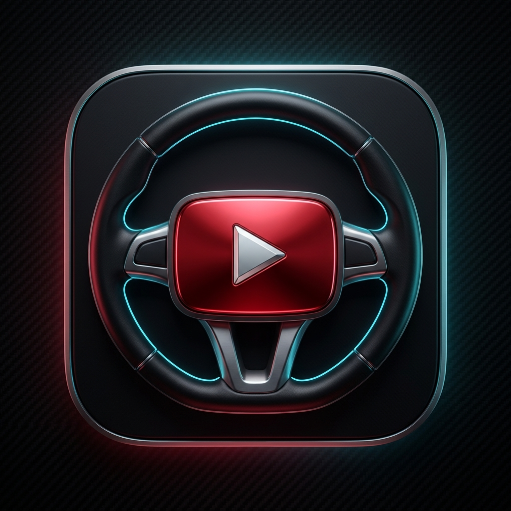
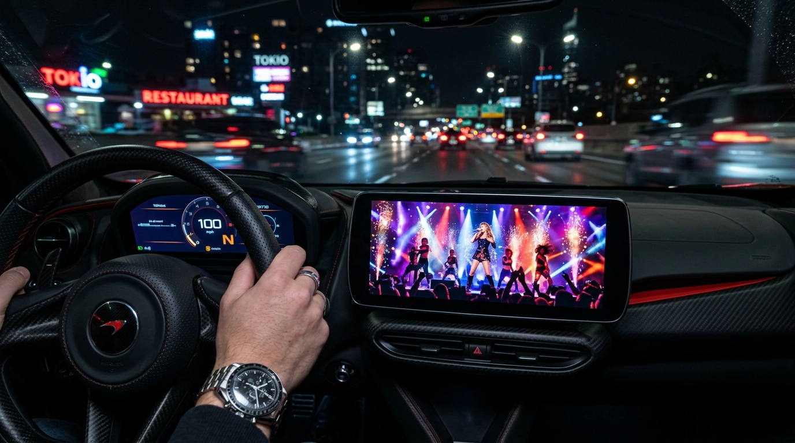
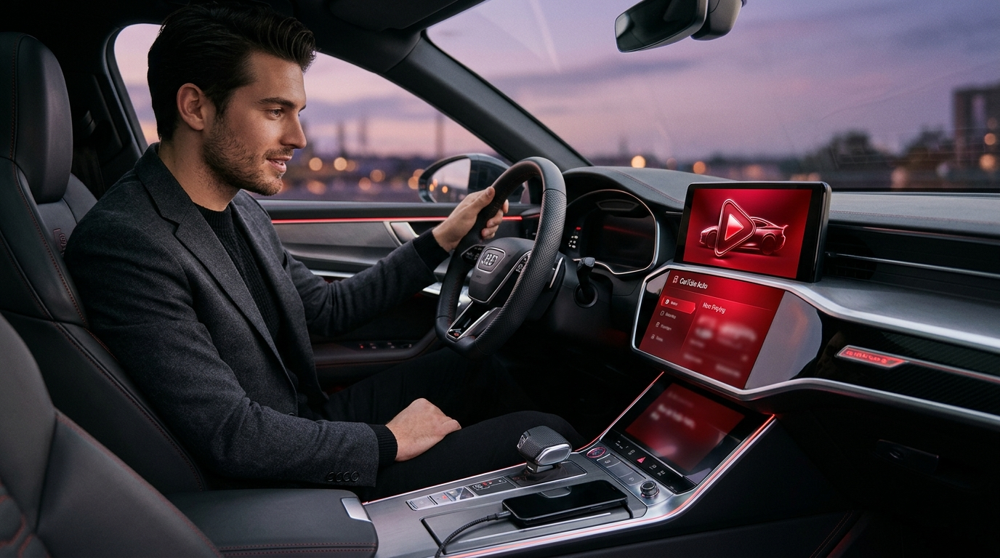
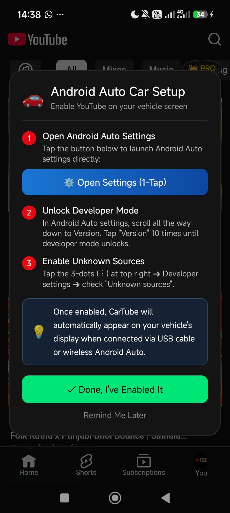
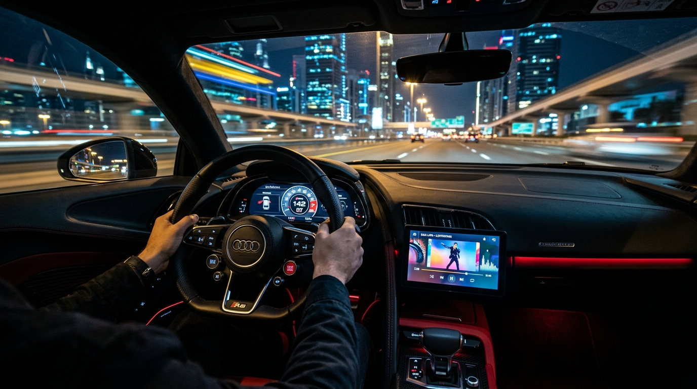

<div align="center">

  

  # CarTube Auto 🚗▶️
  ### The Ultimate Standalone YouTube Player for Android Auto

  [](https://github.com)
  [](https://github.com)
  [](https://github.com/saneru12/cartube-auto/releases/latest)
  [](https://github.com)
  [](https://saneruthisadara.gumroad.com/l/tsnomh)

  <p align="center">
    <strong>Experience YouTube on your vehicle's infotainment screen in true 100% borderless fullscreen without rooting your device!</strong>
  </p>

  <p align="center">
    <a href="#-quick-download">Download APK</a> •
    <a href="#-key-features">Key Features</a> •
    <a href="#-installation-guide-step-by-step">Installation Guide</a> •
    <a href="#-screenshots">Screenshots</a> •
    <a href="#-safety--legal-disclaimer">Safety Disclaimer</a>
  </p>

</div>

---

> [!WARNING]
> ### ⚠️ Safety & Legal Disclaimer
> **CarTube Auto is strictly intended for vehicle passengers and for entertainment while your vehicle is safely parked.**
> In many countries and states, operating or viewing moving video displays within view of the driver while operating a motor vehicle is illegal and highly hazardous. The developer assumes **zero responsibility or liability** for traffic violations, accidents, damages, or personal injury resulting from improper use of this application. **Always keep your eyes on the road and drive responsibly.**

---

## 🌟 Key Features

* 🚗 **True 100% Borderless Fullscreen**: Utilizes custom projection rendering to display YouTube videos edge-to-edge on your car's infotainment screen, completely eliminating ugly black bars and letterboxing.
* 🚫 **Built-In Ad-Blocker**: Enjoy non-stop music playlists, podcasts, and video content without video interruptions or banner ads.
* ⚡ **Zero Root Required**: Built to run completely out-of-the-box on standard, non-rooted Android smartphones from Android 11 up to Android 16 (including HyperOS, One UI, OxygenOS, and Pixel UI).
* 🗺️ **Uninterrupted Background Audio**: Continue listening to your favorite music or podcast audio in the background while using Google Maps or Waze navigation on your dashboard.
* 🎛️ **Steering Wheel Media Controls**: Skip, pause, play, and resume tracks effortlessly using the physical media buttons on your steering wheel.
* 🔊 **Automotive Studio Audio DSP**: Specially calibrated acoustic equalizer featuring **Bass Boost (+3.5 dB @ 75 Hz)** and vocal clarity enhancements tailored for car speaker systems.
* 📱 **Dual Mode Playback**: Works seamlessly as a standalone mobile YouTube player with Picture-in-Picture (PiP) and auto-syncs when plugged into Android Auto.

---

## 📸 Screenshots

<div align="center">
  <table>
    <tr>
      <td width="50%" align="center">
        <strong>100% Borderless Fullscreen on Car Display</strong><br/><br/>
        
      </td>
      <td width="50%" align="center">
        <strong>Instant Cable / Wireless Connection</strong><br/><br/>
        
      </td>
    </tr>
    <tr>
      <td width="50%" align="center">
        <strong>1-Tap Android Auto Setup Guide</strong><br/><br/>
        
      </td>
      <td width="50%" align="center">
        <strong>Highway Cruising with Steering Controls</strong><br/><br/>
        
      </td>
    </tr>
  </table>
</div>

---

## 📥 Quick Download

Get the official, tested, virus-free APK release directly from our GitHub Releases:

| Asset | Version | Compatibility | Download Link |
| :--- | :--- | :--- | :--- |
| **CarTube Auto APK** | `v2.9.2` (Latest) | Android 11, 12, 13, 14, 15, 16 | [⬇️ Download CarTubeAuto-v2.9.2.apk](https://github.com/saneru12/cartube-auto/releases/latest) |

*Includes a **30-Day Free Trial** with all features enabled!*

---

## 🛠️ Installation Guide (Step-by-Step)

Because CarTube Auto is a 3rd-party Android Auto projection application, you need to enable **Unknown Sources** in Android Auto settings once. The built-in 1-Tap setup helper guides you through in less than 10 seconds:

```
[1. Install APK] ➜ [2. Open App on Phone] ➜ [3. Tap "Open Settings (1-Tap)"] ➜ [4. Enable Unknown Sources] ➜ [5. Plug into Car!]
```

### Step 1: Install the APK
1. Download CarTubeAuto-v2.9.2.apk to your Android device.
2. Open your Downloads and tap the APK to install (enable *"Install unknown apps"* for your browser/file manager if prompted).

### Step 2: Open CarTube Auto on Your Phone
1. Launch **CarTube Auto** from your home screen.
2. The **Android Auto Car Setup** dialog will automatically appear on your screen.

### Step 3: Enable "Unknown Sources" in Android Auto (10 Seconds)
1. Tap the blue **"Open Settings (1-Tap)"** button in the dialog. (This takes you straight into your phone's Android Auto settings).
2. Scroll down to the bottom to find **"Version"**.
3. **Tap "Version" 10 times consecutively** until a popup asks: *"Allow development settings?"* — Tap **OK**.
4. Tap the **3-dots menu** at the top-right corner of the screen and choose **"Developer settings"**.
5. Find **"Unknown sources"** and check the box `[✓]`.
6. *(Recommended)* Set **"Application Mode"** to **"Developer"** in the same menu.

### Step 4: Connect to Your Vehicle
1. Connect your smartphone to your vehicle via USB cable (or wireless Android Auto).
2. Look at your car's infotainment touchscreen — **CarTube Auto** will appear on your Android Auto app launcher!
3. Tap **CarTube Auto** on your car display to launch 100% fullscreen YouTube.

---

## ❓ Frequently Asked Questions (FAQ) & Troubleshooting

<details>
<summary><strong>Q: Why doesn't CarTube appear on my vehicle's display?</strong></summary>

1. Ensure you checked **Unknown sources** in Android Auto Developer settings (see Step 3 above).
2. In Android Auto settings on your phone, tap **Customize launcher** and ensure `CarTube Auto` is checked `[✓]`.
3. Unplug and reconnect the USB cable, or reboot your phone once after enabling Unknown Sources.
</details>

<details>
<summary><strong>Q: Does this require rooting my phone?</strong></summary>

**No.** CarTube Auto is built with Google's official Android Auto CarActivity projection protocols. It requires zero root, zero Magisk, and zero bootloader unlocking.
</details>

<details>
<summary><strong>Q: Does steering wheel skip work with YouTube videos?</strong></summary>

**Yes.** CarTube Auto integrates directly with the Android Auto MediaSession API. Pressing the skip/previous buttons on your steering wheel or dashboard will automatically jump to the next video.
</details>

<details>
<summary><strong>Q: Special instructions for Xiaomi / Redmi / HyperOS devices?</strong></summary>

On Xiaomi / Redmi / POCO devices running MIUI or HyperOS:
* Go to **Settings** ➜ **Apps** ➜ **Manage apps** ➜ **CarTube Auto**.
* Set **Battery saver** to **"No restrictions"**.
* Enable **Autostart** so background audio is never terminated by HyperOS memory management.
</details>

---

## 💳 Subscription & Pro Activation

CarTube Auto comes with an unconditional **30-Day Free Trial** giving you unlimited access to all features. 

After your free trial, you can continue your uninterrupted experience with our official monthly membership:
* **Pricing**: **$10.00 / month** (USD)
* **Official Store**: [saneruthisadara.gumroad.com/l/tsnomh](https://saneruthisadara.gumroad.com/l/tsnomh)
* Cancel anytime directly through your email receipt with 1 click.

---

## 📜 License & Copyright

© 2026 **CarTube Auto Team** (`com.saneru.cartube`). All rights reserved.  
*YouTube and Android Auto are registered trademarks of Google LLC. This project is an independent third-party client and is not affiliated with, endorsed by, or sponsored by Google LLC.*
